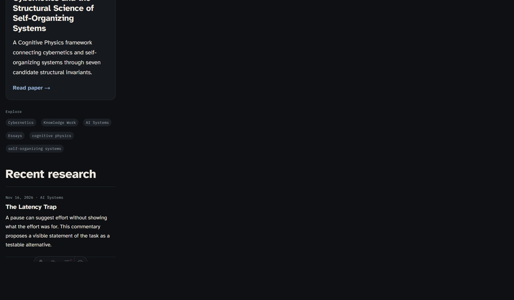
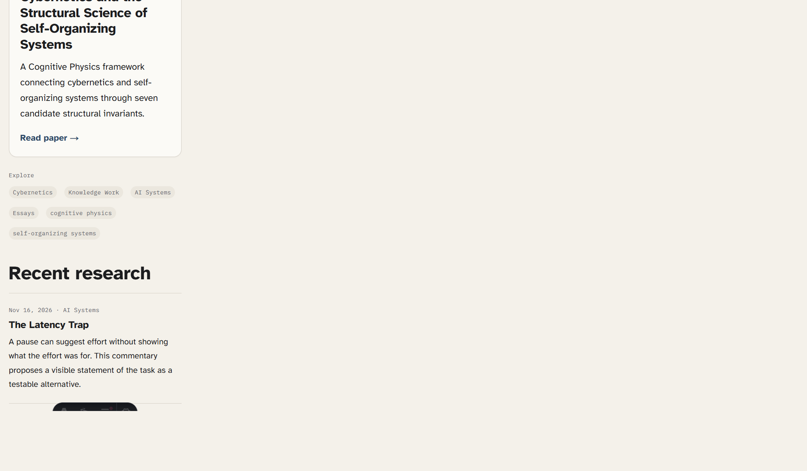

# Homepage Explore strip — sprint intake

Status: **intake for the Planner.** Not a sprint contract. Not a sealed ticket. Not product truth.

The owner reviewed the local mock in dev on 2026-11-19 (“pretty solid”) and asked for this note plus screenshots from `astro dev`. The implementation is in the working tree and is **not authorized for production** until a sealed ticket adopts this spec (or records an explicit departure).

Templates: [`../templates/sprint-contract.md`](../templates/sprint-contract.md), [`../templates/ticket-contract.md`](../templates/ticket-contract.md). Process: [`../../PLANNING.md`](../../PLANNING.md).

Visual evidence: [`./homepage-explore-links/`](./homepage-explore-links/) (PNG captures from `http://localhost:4321/` on 2026-11-19).

## For the planner

| Item | Suggestion |
|---|---|
| Sprint question | Can a first-time reader leave the homepage with category and editorial-tag entry points, without bringing back the T21 category grid or auto-ranked tag clouds? |
| Mode | One `IMPLEMENTATION` ticket (component already sketched locally). |
| Risk ceiling | **R2.** Homepage layout and nav only. Not R3 unless indexing or route policy changes (tag pages stay `noindex`). |
| Branch | `staging`, per `PLANNING.md`. |
| Owner decision already made | Six hard-set chips: four category pillars + two editorial tags. Neutral badges, no counts, no client JS. |

Suggested ticket row:

| Ticket | Mode | Purpose | Depends on | Gate |
|---|---|---|---|---|
| T{n}.0 Homepage Explore | IMPLEMENTATION | Ship `ExploreLinks` per this note | This intake, owner preview | Desktop 1440 and 390 px, light and dark; build fail-closed tests below; keyboard focus on chips; T21 homepage shape unchanged except new region |

## Problem

T21.0 removed the homepage category grid on purpose. Category wayfinding moved to the header, footer, and `/research/`. That is correct for a minimal homepage, but it leaves no on-page bridge between the pinned spotlight and the chronological feed for someone who lands cold.

The footer already lists the four pillars in registry order. The gap is **editorial tags**: tag index pages stay `noindex`, yet `cognitive physics` and `self-organizing systems` are real themes in the corpus. The homepage should surface a **small, owner-curated** set of tag entry points—not a popularity widget and not a second grid.

## Product shape (unchanged except one region)

Homepage vertical order stays T21:

1. Hero (H1 + positioning + About link)
2. Spotlight (`HOMEPAGE_SPOTLIGHT`)
3. **Explore** (new)
4. Recent research feed (5 rows, spotlight excluded)
5. Archive link

No hero CTAs, no category blocks, no tag clouds, no scroll-stealing carousels.

## What ships

### Configuration — [`src/consts.ts`](../../src/consts.ts)

```ts
export const HOMEPAGE_EXPLORE_LINKS = [
	{ kind: 'category', slug: 'cybernetics' },
	{ kind: 'category', slug: 'knowledge-work' },
	{ kind: 'category', slug: 'ai-systems' },
	{ kind: 'category', slug: 'essays' },
	{ kind: 'tag', tag: 'cognitive physics' },
	{ kind: 'tag', tag: 'self-organizing systems' },
] as const;
```

**Edit policy:** Marketing or editorial changes update this array only. No build-time ranking from `tags[]` frequency, no Pagefind, no frontmatter flags for “featured tag.”

### Component — [`src/components/ExploreLinks.astro`](../../src/components/ExploreLinks.astro)

- Server-only Astro; **no `client:*` islands**.
- Resolves each row at build time:
  - **Category:** `isCategorySlug` → `categoryLabel(slug)` + `categoryPath(slug)` (same routes as footer).
  - **Tag:** `slugifyTag(tag)` → `/tags/{slug}/`; label is the **exact** `tags[]` string (sentence case preserved).
- **Fail closed:** invalid category slug or tag with no matching entry throws during `astro build` (same spirit as `HOMEPAGE_SPOTLIGHT`).
- Renders nothing when the resolved list is empty (guard only; with the current six rows it always renders).

### Markup and accessibility

```html
<section class="explore-links" aria-labelledby="explore-links-label">
  <p id="explore-links-label" class="meta explore-links-label">Explore</p>
  <ul class="explore-links-list">
  <!-- each li: a.explore-links-chip > Badge variant="neutral" -->
</section>
```

- Landmark: `section` with programmatic label “Explore” (`aria-labelledby`).
- List semantics: `ul` / `li`; each destination is a single link wrapping the badge text (link name = chip label).
- Focus: `:focus-visible` on the anchor uses global focus ring tokens (`--focus-ring-width`, `--focus-ring`, `--focus-ring-offset`).

### Visual — scoped in `ExploreLinks.astro`

| Rule | Value |
|---|---|
| Container max width | `var(--content-width-wide)` (960px), centered |
| Vertical rhythm | `margin: -1.5em auto 2.5em` (pulls slightly toward spotlight, clears space before “Recent research”) |
| Section label | `.meta` — same eyebrow treatment as “Spotlight” |
| Chip layout | `flex-wrap`, gap `0.65em 0.85em` |
| Chip chrome | `Badge` **`variant="neutral"`** only — **no** pillar tint, **no** category dot |
| Hover | Anchor hover: badge background `color-mix(in oklab, var(--accent) 12%, var(--bg-subtle))`, text `var(--accent)` |
| Counts | None |

**Label casing (intentional asymmetry):**

| Kind | Display |
|---|---|
| Category | Title Case via `categoryLabel` (e.g. Knowledge Work) |
| Tag | Exact frontmatter string (e.g. cognitive physics) |

### Wiring — [`src/pages/index.astro`](../../src/pages/index.astro)

`<ExploreLinks />` immediately after `<Spotlight />`, before `<RecentResearch … />`.

### Removed

`TopicSpots.astro` (if still present on the branch being sealed)—replaced by this component. Do not resurrect auto tag aggregation.

## Non-goals (ticket must not expand scope)

- Markdown, rehype, or research grammar changes.
- Pillar-colored badges on the homepage strip (footer/header already encode category color elsewhere).
- Tag popularity, “related tags,” or dynamic reorder.
- SEO/indexing changes for `/tags/*` (remain human wayfinding; `noindex` policy stands).
- Changes to spotlight selection, feed length, hero copy, or archive link behavior.

## Acceptance criteria

**Build / data**

- [ ] `npm run build` passes with current `HOMEPAGE_EXPLORE_LINKS`.
- [ ] Invalid category slug in the array → build throws with a clear message.
- [ ] Tag string not present on any entry’s `tags[]` → build throws with a clear message.

**Rendered homepage**

- [ ] Exactly one `section` labeled Explore between spotlight card and “Recent research” heading.
- [ ] Six links, in const order, to: `/cybernetics/`, `/knowledge-work/`, `/ai-systems/`, `/essays/`, `/tags/cognitive-physics/`, `/tags/self-organizing-systems/` (or whatever `slugifyTag` produces—verify against live routes).
- [ ] No `client:` scripts added for Explore.
- [ ] T21 invariants still hold: one H1, no category grid, spotlight link present (`validate-research-semantics.mjs` as today).

**Visual / responsive**

- [ ] 1440 px and 390 px: chips wrap cleanly; no horizontal overflow; contrast on neutral badges meets 4.5:1 for text.
- [ ] Light and dark: hover accent readable; focus ring visible on Tab through chips.

**Optional hardening (planner choice, not blocking mock)**

- [ ] Extend `validate-research-semantics.mjs` to assert Explore `href`s for each `HOMEPAGE_EXPLORE_LINKS` row (mirrors spotlight check).

## Dev preview (embedded)

*Local mock, 2026-11-19 — not production.*

### Desktop — light (spotlight → Explore → feed)


### Desktop — dark



### Mobile 390 px — light



### Mobile 390 px — dark


## Relationship to other work

- **T21.0 homepage:** This note **adds** one region; it does not restore the retired category grid. Evidence baseline: [`T21.0-homepage-evidence.md`](./T21.0-homepage-evidence.md).
- **Reading surface intake:** Separate track ([`reading-surface-sprint-intake.md`](./reading-surface-sprint-intake.md)). No shared ticket unless the planner explicitly bundles (not recommended).

## File checklist for Executor (when sealed)

| File | Action |
|---|---|
| `src/consts.ts` | `HOMEPAGE_EXPLORE_LINKS` |
| `src/components/ExploreLinks.astro` | new |
| `src/pages/index.astro` | import + placement |
| `src/components/TopicSpots.astro` | delete if present |
| `design-system/components.md` | document Explore strip (neutral badges, edit via consts) |
| `planning/audits/homepage-explore-links-spec.md` | keep as intake reference; optional evidence appendix after staging |

---

*Intake author: Executor preview session. Owner sign-off on visuals: 2026-11-19 conversation.*