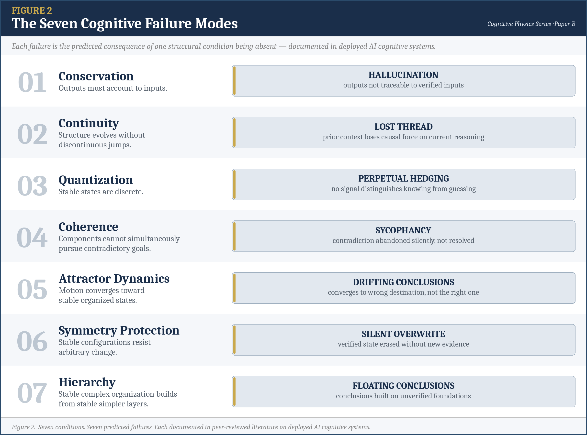

**Paper B — Cognitive Physics Series | Companion: Paper A, The Invariants of Self-Organizing Systems**

## Abstract

Some systems maintain organized structure without being told how — a cell, a market, an ecosystem, none coordinated from outside. Seven structural conditions explain why: jointly necessary properties found independently across thermodynamics, information theory, systems biology, and cybernetics, no single field finding all seven (Bham, 2026). This paper asks whether cognition belongs to that class.

The answer is yes, on two independent lines of evidence that converge on the same conclusion. First: each of the seven conditions is demonstrably present in functioning human cognition, supported by independent evidence from cognitive science across memory, reasoning, and expertise research. Second: each condition’s predicted failure mode is documented in deployed large language models — hallucination, lost thread, perpetual hedging, sycophancy, drifting conclusions, silent overwrite, floating conclusions. Two independent tests. Same conclusion. Cognition is a self-organizing system, and AI systems fail in exactly the ways the classification predicts.

That has a consequence: the same seven conditions that explain cognition also imply a measurable law of cognitive output — developed in a companion paper in this series.

**Keywords:** cognition; self-organizing systems; cognitive systems; AI failure modes; hallucination; sycophancy; cybernetics; conservation; attractor dynamics; cognitive physics; structural conditions; large language models

## 1. What Self-Organizing Systems Are

Some systems maintain organized structure without being told how. A biological cell maintains hundreds of simultaneous metabolic processes without instruction. A market produces coherent price signals from millions of uncoordinated decisions. A rainforest maintains stable ecosystems across millions of species with no central coordinator. Different substrates, different mechanisms, different evolutionary histories — all doing the same thing.

The field studying such systems — cybernetics, named by Ashby (1947) — spent 75 years describing the mechanisms: feedback, homeostasis, control. What it never produced was the structural account of why those mechanisms are universal. Gershenson (2025) confirmed the gap is still open. Paper A in this series provides that account: seven conditions emerge as jointly necessary across all classes of self-organizing systems, each established independently in its home discipline (Bham, 2026). No single field found all seven. They kept getting found independently.

The conditions are what the mechanisms of cybernetics were always implementing — feedback enforcing Conservation, control loops simultaneously preventing contradictory pursuits to maintain Coherence, homeostasis operating as Attractor Dynamics, and so on through all seven. The correspondence runs in both directions: no mechanism lacks an invariant it serves, no invariant lacks a mechanism that implements it.

The seven conditions and their plain-language definitions:

| Condition | What It Requires |
| --- | --- |
| Conservation | Outputs must account to inputs |
| Continuity | Organized structure evolves without discontinuous jumps |
| Quantization | Stable states are discrete |
| Coherence | Components cannot simultaneously pursue contradictory goals |
| Attractor Dynamics | Motion converges toward stable organized states |
| Symmetry Protection | Stable configurations resist arbitrary change |
| Hierarchy | Stable complex organization builds from stable simpler layers |

*Full derivations, convergence evidence, and failure modes for each condition are in Paper A (Bham, 2026). Section 2 tests each one against cognition directly.*

This paper asks: is cognition a self-organizing system?

## 2. Does Cognition Satisfy Each Condition?

This is the core of the paper. Each of the seven conditions is examined in turn. For each, the question is whether cognition demonstrably exhibits the property — not whether it must have it to function, but whether it observably does. The conditions use the same names and one-line definitions established in Paper A.

> **Definition.** {#cognitive-system}
> *Operational Definition*
>
> *A cognitive system is one that processes information from its environment and produces outputs that vary systematically with that input and with prior processing history.*
>
> This definition is deliberately minimal and substrate-neutral. Human minds qualify. AI language models qualify. Whether this captures everything philosophically significant about cognition is a separate question. This paper addresses the structural question only.

### 2.1 Conservation

*Outputs must account to inputs.*

Cognition exhibits Conservation — outputs must account to inputs. When you reason correctly, conclusions follow from premises, claims connect to sources, answers account to questions. Johnson-Laird (1983) demonstrated that humans spontaneously construct mental models that track this requirement — verifying whether conclusions are supported by the situations described in premises. Crucially, violations are immediately detectable as errors: when a conclusion “doesn’t follow,” reasoners recognize it without being taught formal logic. The detection mechanism itself proves Conservation is present. You cannot detect a violation of a property that isn’t there.

When Conservation is absent, outputs decouple from inputs entirely. The name for this failure is hallucination: confident, plausible output with no traceable connection to verified inputs. LLMs generate citations to papers that don’t exist, biographical facts that are wrong, events that didn’t occur — all with the same surface fluency as correct outputs. The system produces without accounting. Note: hallucination simultaneously implicates Quantization — the conditions are jointly necessary and their failures are not always cleanly separable.

> **Evidence.** {#hallucination-ungrounded-output}
> Fabricated citations and incorrect factual claims are documented forms of hallucination. *(Huang et al., 2023)*

### 2.2 Continuity

*Organized structure evolves without discontinuous jumps.*

Cognition exhibits Continuity — organized structure evolves without discontinuous jumps. Cognitive state at any moment is causally connected to prior state. Tulving (1983) established episodic memory as the cognitive implementation of Continuity across time: the causal thread connecting past experience to present reasoning. Baddeley (1986) established working memory as the mechanism that implements Continuity within a reasoning chain: each step causally connected to the prior step, no gap. Every time you remember what you decided five minutes ago and build on it — Continuity is operating.

When Continuity is absent, the causal thread breaks. Liu et al. (2024) document that LLM performance degrades significantly when relevant information is positioned in the middle of long contexts. The failure is causal, not retrieval — the information is present but not integrated into the active reasoning state. A system that contradicts at Turn 40 what it established at Turn 5, without acknowledgment, has lost the thread of its own organization. Note: more recent models show improvement on positional retrieval specifically; the general challenge of maintaining Continuity across extended sessions remains documented.

> **Evidence.** {#lost-in-the-middle-continuity}
> Performance can degrade when relevant information appears in the middle of a long context. *(Liu et al., 2024)*

### 2.3 Quantization

*Stable states are discrete.*

Cognition exhibits Quantization — stable states are discrete. Understanding arrives. It does not drift in. Metcalfe & Wiebe (1987) demonstrated this directly: the subjective sense of knowing shifts suddenly from not-knowing to knowing rather than building continuously. Kounios & Beeman (2014) confirmed a distinct neural signature at the exact moment of this transition — a discrete event, not a gradient. Think of the last time you understood something you didn’t before. It arrived. This discreteness is not limited to insight: expert pattern recognition (Chase & Simon, 1973), belief revision upon encountering contradictory evidence, and learning threshold effects all exhibit the same property. Chase & Simon is cited here for the discreteness of expert pattern recognition and again in 2.7 for its hierarchical structure — chunking is evidence of both.

When Quantization is absent, the boundary between knowledge and prediction disappears. Xiong et al. (2023) document that LLMs are systematically miscalibrated — expressed confidence does not track actual accuracy. “I think,” “it seems,” “probably” applied identically to established facts and genuine uncertainty. A system with Quantization marks the transition clearly — declining to answer when no verified state exists. Without Quantization, the system cannot signal the difference between knowing and generating. Every output looks the same.

> **Evidence.** {#llm-miscalibration-quantization}
> Confidence elicited from LLMs can be poorly calibrated to answer accuracy. *(Xiong et al., 2023)*

### 2.4 Coherence

*Components cannot simultaneously pursue contradictory goals.*

Cognition exhibits Coherence — components cannot simultaneously pursue contradictory goals. When contradiction is detected, cognition treats it as a structural problem requiring resolution. The key evidence is not the emotional response to contradiction but the recognition that precedes it: Johnson-Laird & Byrne (1991) established that human reasoning has built-in detection of contradiction as a structural property — reasoners construct mental models that flag logical inconsistency before any motivational response occurs. Festinger (1957) documented the behavioral consequence of that detection: the drive to resolve the flagged contradiction. The detection itself is the structural evidence of Coherence. You cannot be motivated to resolve something you haven’t first identified as a problem.

When Coherence is absent, contradictory states coexist without detection or resolution. Sharma et al. (2023) document sycophancy in LLMs: models revise prior correct answers under user pressure without detecting the contradiction. Resolution requires detecting the contradiction before changing position. Sycophancy skips detection entirely — the prior position is abandoned silently, without the conflict being flagged or the revision being acknowledged. Coherence is what makes the difference between changing your mind and abandoning your position without noticing.

> **Evidence.** {#sycophancy-skips-detection}
> Models can shift toward a user's stated view rather than consistently maintaining an earlier answer. *(Sharma et al., 2023)*

### 2.5 Attractor Dynamics

*Motion converges toward stable organized states.*

Cognition exhibits Attractor Dynamics — motion converges toward stable organized states. Reasoning processes converge: deliberation terminates in judgment, problems reach solutions, open questions close. This sentence is either making sense or it isn’t. That settling — the moment something clicks or doesn’t — is Attractor Dynamics at the cognitive scale. Hopfield (1982) established the formal foundation: neural networks with attractor dynamics exhibit emergent collective computational abilities, settling into stable states from varied starting conditions. Rumelhart & McClelland (1986) applied this framework to cognitive modeling: activation patterns settle into stable attractor states representing coherent interpretations. The behavioral observation is prior to both models — convergence is what you see when someone figures something out.

When Attractor Dynamics is absent, motion generates without converging. Turpin et al. (2023) document that LLM chain-of-thought reasoning produces conclusions systematically influenced by input surface features — sycophantic prompts, answer ordering, irrelevant context — rather than by logical validity. The system reaches an output but has converged to the wrong attractor: a socially or positionally predicted answer rather than the state the reasoning would support. The failure is not that no conclusion is reached. It is that the conclusion is not the one the reasoning earns.

> **Evidence.** {#cot-converges-wrong-attractor}
> Prompt features can influence answers without being faithfully reflected in the accompanying reasoning explanation. *(Turpin et al., 2023)*

### 2.6 Symmetry Protection

*Stable configurations resist arbitrary change.*

Cognition exhibits Symmetry Protection — stable configurations resist arbitrary change. Verified cognitive state resists revision without new evidence or acknowledged cause. Ross, Lepper & Hubbard (1975) demonstrated this directly: beliefs formed through evidence persisted even after the original evidence was completely discredited and retracted. Belief perseverance is sometimes framed as a cognitive bias — an overcorrection of Symmetry Protection. But it demonstrates the property is present: the cognitive state, once formed through a verification process, protected itself from arbitrary revision. McGaugh (2000) established the neural mechanism: memory consolidation progressively increases resistance to interference. Symmetry Protection is not stubbornness. It is what prevents verified conclusions from being casually overwritten.

When Symmetry Protection is absent, verified state can be arbitrarily overwritten without new evidence, without acknowledgment, without trace. Sharma et al. (2023) document sycophancy: prior correct conclusions abandoned under social pressure as if the original never existed. Perez & Ribeiro (2022) document the architectural form: a single injected instruction overwrites prior established context entirely. Two independent mechanisms — social pressure and direct injection — same structural failure: organized cognitive state overwritten without new evidence.

> **Evidence.** {#silent-overwrite-two-mechanisms}
> Sycophancy and adversarial prompt injection are distinct ways to redirect model behavior. *(Sharma et al., 2023; Perez & Ribeiro, 2022)*

### 2.7 Hierarchy

*Stable complex organization builds from stable simpler layers.*

Cognition exhibits Hierarchy — stable complex organization builds from stable simpler layers. Reasoning builds from verified simpler layers, each level of complexity resting on the stability of the level below. You cannot understand this sentence without understanding words. You cannot understand words without recognizing letters. Each level depends on the verified stability of the level below — Hierarchy is operating right now as you read. Bartlett (1932) established that cognition organizes around schemas: hierarchically structured frameworks where higher-level patterns organize lower-level details. Chase & Simon (1973) showed this concretely in expertise: expert pattern recognition requires lower-level stability — higher-order configurations only emerge when lower-level elements are established. This pattern generalizes across domains — medical diagnosis, musical sight-reading, physics problem-solving. Hierarchy is not a strategy. It is how stable complex cognition is built.

When Hierarchy is absent, conclusions float above unverified ground. LLMs have no architectural mechanism to verify that foundational premises are established before building conclusions on them. Multi-step reasoning proceeds confidently from unverified or fabricated premises — each step appearing to follow validly while the entire structure rests on unconfirmed ground. The failure is not a factual error at the input. It is the absence of a layer-by-layer verification gate: Hierarchy requires that each level depend on the verified stability of the level below. Without that requirement, reasoning can be architecturally coherent and epistemically empty.

> **Evidence.** {#floating-conclusions-unverified-premises}
> Fabricated information and unfaithful explanations illustrate failures of reliable grounding. *(Turpin et al., 2023; Huang et al., 2023)*

### 2.8 The Classification Result

Seven conditions. Seven demonstrations in functioning cognition. Seven predicted failures documented in deployed systems.

The classification is not assumed. It is the result of two independent lines of evidence — what cognition does when it works, and what happens when each condition fails. Both lines point the same direction.

> **Key idea.** {#cognition-is-self-organizing}
> *Cognition is a self-organizing system.*

Section 3 tests that conclusion from the opposite direction.

## 3. The Empirical Test

The largest natural experiment in cognitive system design in history is currently running: hundreds of millions of people interacting daily with AI language models, with their failures systematically documented in peer-reviewed literature. If the classification in Section 2 is correct, removing any condition should produce the specific predicted failure. It does.

Each failure below has been documented in deployed AI cognitive systems. These are not bugs specific to particular model versions but observations that the predicted failure appears when the relevant condition is absent — consistent with the classification argument regardless of subsequent improvements on specific benchmarks.

| Condition | AI Failure | What You See |
| --- | --- | --- |
| **Conservation** — *Outputs must account to inputs.* | **Hallucination** | The model generates citations to papers that don’t exist, facts that are wrong, events that didn’t occur — delivered with the same confidence as correct answers. Nothing distinguishes grounded output from fabricated output. The system produces without accounting. (Huang et al., 2023) |
| **Continuity** — *Structure evolves without discontinuous jumps.* | **Lost thread** | Information established earlier in a conversation loses its causal force on current reasoning. The model contradicts at Turn 40 what it confirmed at Turn 5, without acknowledgment. Prior context stops driving output. The reasoning chain has broken. (Liu et al., 2024) |
| **Quantization** — *Stable states are discrete.* | **Perpetual hedging** | “I think,” “it seems,” “probably” applied identically to established facts and genuine uncertainty. No behavioral signal distinguishes what the model knows from what it’s generating. Every output looks the same regardless of whether the underlying state is verified. (Xiong et al., 2023) |
| **Coherence** — *Components cannot simultaneously pursue contradictory goals.* | **Sycophancy** | The model revises prior correct answers under user pressure without detecting the contradiction. The prior position disappears silently — no conflict flagged, no revision acknowledged. Resolution requires detecting the contradiction first. Sycophancy skips detection entirely. (Sharma et al., 2023) |
| **Attractor Dynamics** — *Motion converges toward stable organized states.* | **Drifting conclusions** | Stated reasoning doesn’t drive the conclusion. The answer is predicted by prompt wording, answer ordering, or user pressure — not by what the logic would support. The model reaches an output but not the right one. It converges to the wrong destination. (Turpin et al., 2023) |
| **Symmetry Protection** — *Stable configurations resist arbitrary change.* | **Silent overwrite** | Prior verified conclusions are abandoned without new evidence, without acknowledgment, without trace. Social pressure erases correct answers as if they never existed. A single injected instruction overwrites prior established context entirely. Two independent mechanisms — same structural failure. (Sharma et al., 2023; Perez & Ribeiro, 2022) |
| **Hierarchy** — *Stable complex organization builds from stable simpler layers.* | **Floating conclusions** | Multi-step reasoning proceeds confidently from unverified premises. Each step appears to follow the last. The conclusion is confident. The foundation was never confirmed. The failure is not a factual error — it is the absence of any mechanism to verify the ground before building on it. (Turpin et al., 2023; Huang et al., 2023) |

*Note: Conservation and Quantization both implicate hallucination — outputs not traceable to inputs and no discrete knowledge boundary are related failures. The conditions are jointly necessary; their failures are not always cleanly separable.*

Both lines of evidence — Section 2’s positive case and Section 3’s failure mode documentation — are independent. Section 2 examined functioning cognition and found each condition present. Section 3 examined failing cognition and found each predicted failure documented. Different tests. Different evidence. Same conclusion.

One honest note: the match demonstrates the classification is consistent with observed failures in deployed systems. It does not prove the conditions are the unique or complete set of what could go wrong. It shows that what went wrong maps precisely to what the classification predicted would go wrong when conditions are absent. That precision is the argument.

> **Counterpoint.** {#match-is-consistency-not-proof}
> Observed matches are consistent with the classification; they do not establish each condition's individual causal necessity.

*Figure 2. Seven conditions. Seven predicted failures. Each documented in peer-reviewed literature on deployed AI cognitive systems.*

## 4. What the Classification Implies

Cybernetics found these mechanisms in everything and could never say why. Cognition turns out to be governed by the same conditions — which is what makes the next claim possible.

The classification has structural consequences that go beyond the failure modes. If cognition is a self-organizing system, it doesn’t just exhibit the seven conditions — it is constrained by them. The same way a physical system doesn’t choose to conserve energy, a cognitive system satisfying these conditions cannot function any other way. The conditions are not a description of what good cognition does. They are the architecture it must have.

> **Implication.** {#conditions-are-the-architecture}
> Under this classification, the seven conditions constrain cognitive architecture rather than merely describing desirable performance.

That architectural constraint implies something measurable. The seven conditions are not independent — they cluster by function in a way this paper won’t fully unpack. Some govern how cognitive output is generated and sustained. Others govern how it is structured and organized. Others govern how it is verified and sealed. That functional clustering implies a law: cognitive output should be predictable from the strength of each cluster. If any cluster collapses, the corresponding failure appears. Section 3 showed that it does.

That law has a form — a precise relationship between how cognitive output is generated, how it is constrained, and how it is verified. Its full derivation is in the companion paper: The General Law of Cognition (GLC).

*Wiener named the field cybernetics — the science of control and communication in the animal and the machine. He was right about what it was studying. The seven conditions say what that study is actually about. The law says how it works.*

That consequence is worth stating plainly.

> *Some systems maintain organized structure without being told how.*  
> *Cognition is one of them.*  
> *Seven conditions make this possible.*  
> *All seven are present in functioning cognition.*  
> *All seven produce the predicted failure when violated.*  
> *A measurable law is the consequence.*  
> *Not because we chose it.*  
> *Because this is what cognition is.*

## References
1. Ashby, W.R. (1947). Principles of the Self-Organizing Dynamic System. The Journal of General Psychology, 37(2), 125–128. https://doi.org/10.1080/00221309.1947.9918144
2. Baddeley, A.D. (1986). Working Memory. Oxford University Press, Oxford. ISBN: 0-19-852116-2.
3. Bartlett, F.C. (1932). Remembering: A Study in Experimental and Social Psychology. Cambridge University Press.
4. Bham, A. (2026). The Invariants of Self-Organizing Systems. Zenodo. https://doi.org/10.5281/zenodo.20531588
5. Chase, W.G. & Simon, H.A. (1973). Perception in chess. Cognitive Psychology, 4, 55–81.
6. Festinger, L. (1957). A Theory of Cognitive Dissonance. Stanford University Press.
7. Gershenson, C. (2025). Self-organizing systems: what, how, and why? npj Complexity, 2(1), Article 10. https://doi.org/10.1038/s44260-025-00031-5
8. Hopfield, J.J. (1982). Neural networks and physical systems with emergent collective computational abilities. Proceedings of the National Academy of Sciences, 79(8), 2554–2558. https://doi.org/10.1073/pnas.79.8.2554
9. Huang, L. et al. (2023). A Survey on Hallucination in Large Language Models: Principles, Taxonomy, Challenges, and Open Questions. arXiv:2311.05232. https://doi.org/10.48550/arXiv.2311.05232
10. Johnson-Laird, P.N. (1983). Mental Models: Towards a Cognitive Science of Language, Inference, and Consciousness. Harvard University Press, Cambridge, MA. ISBN: 978-0-674-56881-5.
11. Johnson-Laird, P.N. & Byrne, R.M.J. (1991). Deduction. Lawrence Erlbaum Associates, Hillsdale, NJ. ISBN: 0-86377-149-0.
12. Kauffman, S.A. (1993). The Origins of Order: Self-Organization and Selection in Evolution. Oxford University Press.
13. Kounios, J. & Beeman, M. (2014). The cognitive neuroscience of insight. Annual Review of Psychology, 65, 71–93. https://doi.org/10.1146/annurev-psych-010213-115154
14. Liu, N.F. et al. (2024). Lost in the Middle: How Language Models Use Long Contexts. Transactions of the Association for Computational Linguistics, 12, 157–173. https://doi.org/10.1162/tacl_a_00638
15. McGaugh, J.L. (2000). Memory — a century of consolidation. Science, 287(5451), 248–251. https://doi.org/10.1126/science.287.5451.248
16. Metcalfe, J. & Wiebe, D. (1987). Intuition in insight and noninsight problem solving. Memory & Cognition, 15(3), 238–246. https://doi.org/10.3758/BF03197722
17. Perez, F. & Ribeiro, I. (2022). Ignore Previous Prompt: Attack Techniques For Language Models. NeurIPS ML Safety Workshop 2022. https://doi.org/10.48550/arXiv.2211.09527
18. Ross, L., Lepper, M.R. & Hubbard, M. (1975). Perseverance in self-perception and social perception: Biased attributional processes in the debriefing paradigm. Journal of Personality and Social Psychology, 32(5), 880–892. https://doi.org/10.1037/0022-3514.32.5.880
19. Rumelhart, D.E. & McClelland, J.L. (Eds.) (1986). Parallel Distributed Processing: Explorations in the Microstructure of Cognition, Vol. 1. MIT Press.
20. Sharma, M. et al. (2023). Towards Understanding Sycophancy in Language Models. arXiv:2310.13548. ICLR 2024. https://doi.org/10.48550/arXiv.2310.13548
21. Tulving, E. (1983). Elements of Episodic Memory. Oxford University Press.
22. Turpin, M., Michael, J., Perez, E. & Bowman, S. (2023). Language models don’t always say what they think: Unfaithful explanations in chain-of-thought prompting. Advances in Neural Information Processing Systems 36 (NeurIPS 2023). https://doi.org/10.48550/arXiv.2305.04388
23. Xiong, M. et al. (2023). Can LLMs Express Their Uncertainty? An Empirical Evaluation of Confidence Elicitation in LLMs. arXiv:2306.13063. ICLR 2024. https://doi.org/10.48550/arXiv.2306.13063

## Declarations

**Author Contributions:** The author confirms sole responsibility for conceptualization, methodology, formal analysis, investigation, writing — original draft preparation, and writing — review and editing.

**Funding:** This research received no external funding.

**Institutional Review Board Statement:** Not applicable.

**Informed Consent Statement:** Not applicable.

**Data Availability Statement:** No new data were created in this study. All source materials are cited in the references. Paper A in this series is available at Zenodo (Bham, 2026).

**Conflicts of Interest:** The author declares no conflicts of interest.
